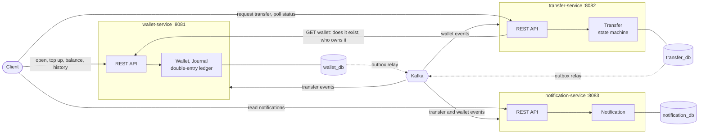
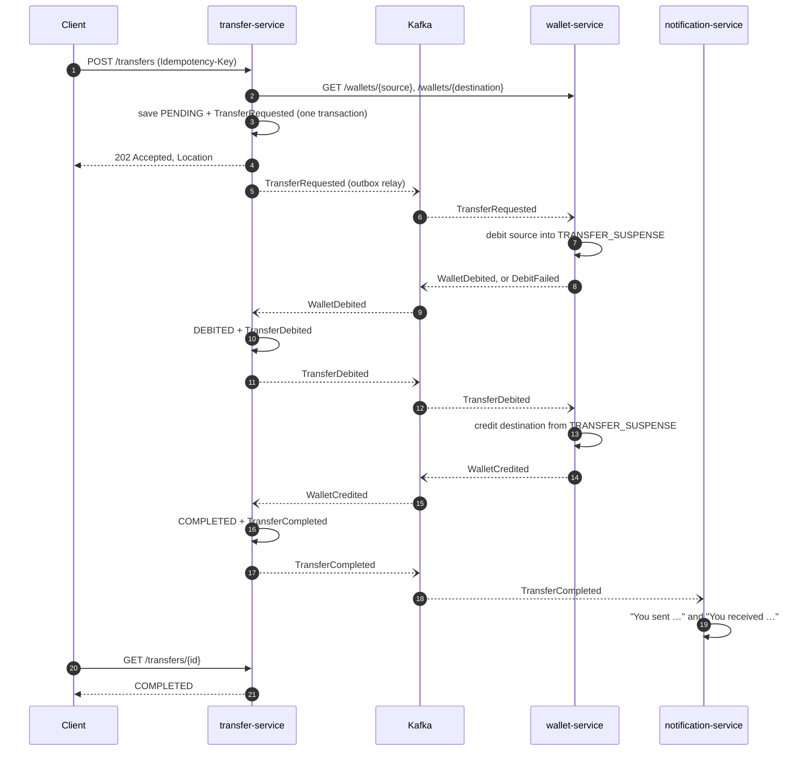
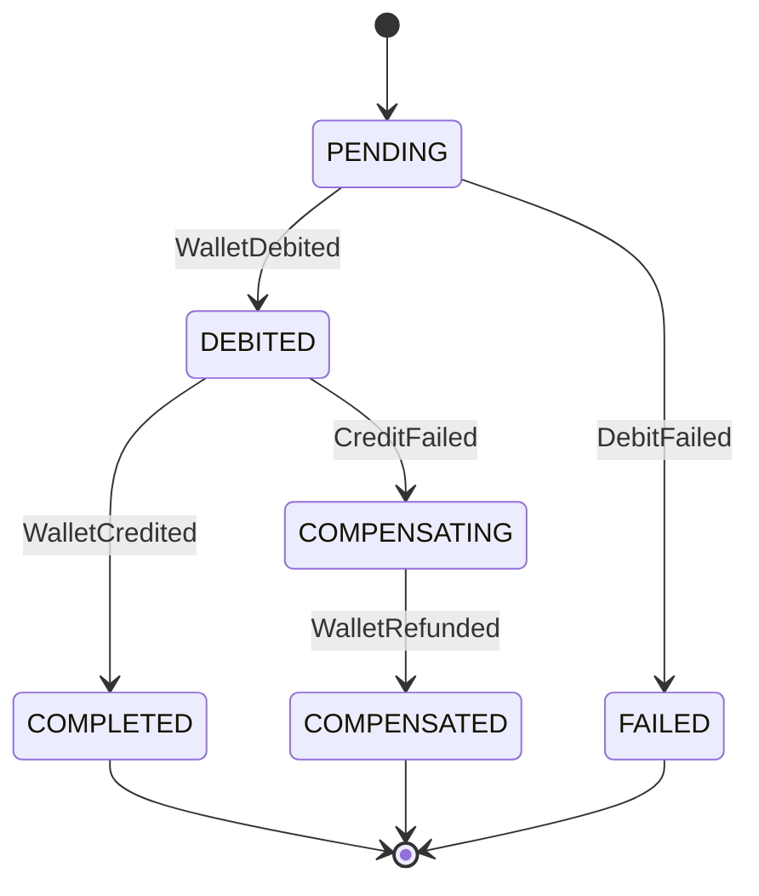

# mini-ewallet

A backend for an e-wallet: three Spring Boot services that keep balances in a
double-entry ledger and move money between wallets with a Kafka saga. This page
is for developers and reviewers who want to run it and see how it works.

**Status (2026-11-17):** complete. The services provide wallets, top-up,
peer-to-peer transfer with compensation, and notifications. The repository also
has concurrency tests, end-to-end scenarios and a load test.

## Demo

https://github.com/user-attachments/assets/ab5e8f7d-f1db-4314-94a1-0902e357e126

*Three minutes on the running stack, through each service's Swagger UI.
Alice and Bob open wallets, and Alice tops up; a retry with the same
`Idempotency-Key` is replayed, not credited twice. A transfer goes from
`PENDING` to `COMPLETED` over the saga. A transfer larger than the balance
ends `FAILED`. The video then shows the ledger history, notifications and
the empty dead-letter list.*

## Stack

Java 21, Spring Boot 3.5, Spring Data JPA and JDBC, Flyway, MySQL 8.4,
Kafka 4.3 (KRaft), JUnit 5, AssertJ, Mockito, Testcontainers, Cucumber,
JaCoCo, k6, springdoc-openapi, Docker Compose.

## Architecture



*Each service owns one MySQL schema and its own least-privilege user. The
services talk through two topics, `ewallet.transfer.events.v1` and
`ewallet.wallet.events.v1`, with three partitions each and the transfer id as
the key. The only synchronous call is the wallet lookup when a transfer is
requested.*

### The transfer saga



*If the debit is refused (`DebitFailed`), the transfer ends `FAILED`. If the
credit is refused (`CreditFailed`, for example when the destination would go
over its 20,000,000.00 balance limit), the transfer becomes `COMPENSATING`. The
wallet service then refunds the source from suspense, and the transfer ends
`COMPENSATED`.*



*A step applies only in the state it belongs to, so a duplicated or late
event changes nothing.*

## Run it

Prerequisites: Docker with Compose v2.

```bash
docker compose up -d --build --wait
```

This starts MySQL, Kafka and the three services. Each service has a Swagger UI:

| Service | Swagger UI |
|---|---|
| wallet-service | http://localhost:8081/swagger-ui/index.html |
| transfer-service | http://localhost:8082/swagger-ui/index.html |
| notification-service | http://localhost:8083/swagger-ui/index.html |

To stop it, run `docker compose down`. Add `-v` to also delete the data.

## Try the API

The responses below were captured from the running stack.

### 1. Open two wallets and top one up

```bash
curl -s -X POST localhost:8081/api/v1/wallets \
  -H 'Content-Type: application/json' -d '{"userId":"alice"}'
```

```json
{"walletId":"5f7c29e1-2801-497f-9811-b636597dbf03","userId":"alice","balance":"0.00","currency":"IDR"}
```

Open `bob`'s wallet the same way, then top up `alice`'s. The `Idempotency-Key`
header makes the request safe to retry:

```bash
curl -s -X POST localhost:8081/api/v1/wallets/<aliceWalletId>/top-ups \
  -H 'Content-Type: application/json' -H 'Idempotency-Key: tu-001' \
  -d '{"amount":"150000.00"}'
```

```json
{"topUpId":"01deeb3b-20ff-46ce-90e4-122bc0a58105","walletId":"5f7c29e1-2801-497f-9811-b636597dbf03","amount":"150000.00","balanceAfter":"150000.00","createdAt":"2026-11-17T10:22:19.289085Z"}
```

| Request | Response |
|---|---|
| first call | `201 Created`, the receipt |
| same key, same amount | `200 OK`, the same receipt, `Idempotent-Replayed: true`, no second credit |
| same key, other amount | `422`, `"code":"IDEMPOTENCY_KEY_REUSED"` |
| amount `10.005` | `400`, `"code":"INVALID_AMOUNT"` |
| amount above 10,000,000.00 | `422`, `"code":"TOP_UP_LIMIT_EXCEEDED"` |

### 2. Transfer

```bash
curl -s -i -X POST localhost:8082/api/v1/transfers \
  -H 'Content-Type: application/json' -H 'Idempotency-Key: tf-001' \
  -d '{"sourceWalletId":"<aliceWalletId>","destinationWalletId":"<bobWalletId>","amount":"40000.00"}'
```

```
HTTP/1.1 202
Location: /api/v1/transfers/8d75affa-4901-4d21-bc14-bd0432916983
```

```json
{"transferId":"8d75affa-4901-4d21-bc14-bd0432916983","sourceWalletId":"5f7c29e1-2801-497f-9811-b636597dbf03","destinationWalletId":"8c22843a-d183-4f0e-b23c-30babd344734","amount":"40000.00","currency":"IDR","status":"PENDING","failureReason":null,"createdAt":"2026-11-17T10:22:19.457213Z","updatedAt":"2026-11-17T10:22:19.457213Z"}
```

The transfer is accepted, not finished. Poll it until its status is final:

```bash
curl -s localhost:8082/api/v1/transfers/<transferId>
```

```json
{"transferId":"8d75affa-4901-4d21-bc14-bd0432916983","sourceWalletId":"5f7c29e1-2801-497f-9811-b636597dbf03","destinationWalletId":"8c22843a-d183-4f0e-b23c-30babd344734","amount":"40000.00","currency":"IDR","status":"COMPLETED","failureReason":null,"createdAt":"2026-11-17T10:22:19.457213Z","updatedAt":"2026-11-17T10:22:19.832372Z"}
```

| Request | Response |
|---|---|
| first call | `202 Accepted`, `Location` of the transfer |
| same key, same body | `200 OK`, the same transfer, `Idempotent-Replayed: true` |
| same key, other body | `422`, `"code":"IDEMPOTENCY_KEY_REUSED"` |
| unknown wallet | `404`, `"code":"WALLET_NOT_FOUND"` |
| source equals destination | `422`, `"code":"SAME_WALLET"` |
| amount above 10,000,000.00 | `422`, `"code":"TRANSFER_LIMIT_EXCEEDED"` |
| wallet service down | `503`, `"code":"WALLET_SERVICE_UNAVAILABLE"`, nothing stored |
| more than the balance | `202`, then `FAILED` with `"failureReason":"INSUFFICIENT_BALANCE"` |

### 3. Balances, history and notifications

```bash
curl -s localhost:8081/api/v1/wallets/<bobWalletId>
curl -s "localhost:8081/api/v1/wallets/<aliceWalletId>/transactions?page=0&size=20"
curl -s localhost:8083/api/v1/users/bob/notifications
```

```json
{"walletId":"8c22843a-d183-4f0e-b23c-30babd344734","userId":"bob","balance":"40000.00","currency":"IDR"}
```

```json
[{"journalId":"cead421d-1fd4-4698-9b2f-a9c1d4302b71","type":"TRANSFER_OUT","direction":"DEBIT","amount":"40000.00","balanceAfter":"110000.00","reference":"8d75affa-4901-4d21-bc14-bd0432916983","postedAt":"2026-11-17T10:22:19.499849Z"},
 {"journalId":"7b753cf7-4dea-436c-b254-9cf76706e4ca","type":"TOP_UP","direction":"CREDIT","amount":"150000.00","balanceAfter":"150000.00","reference":"01deeb3b-20ff-46ce-90e4-122bc0a58105","postedAt":"2026-11-17T10:22:19.289085Z"}]
```

```json
[{"notificationId":"68ef68a5-289c-4f9a-ae0a-f785f18d33e1","type":"TRANSFER_RECEIVED","message":"You received 40000.00 IDR from alice.","eventId":"02d903b2-04a6-4c56-962f-83c82a9d1334","createdAt":"2026-11-17T10:22:19.833930Z"}]
```

Records that a consumer could not process after its retries are listed at
`GET localhost:8083/api/v1/dead-letters`.

Amounts are decimal strings with at most two decimals, so no client parses
them into a float. Errors are RFC 7807 problem documents with a stable `code`.

## How the money is kept right

- **Double-entry ledger.** Every movement is a journal whose debits equal its
  credits, and ledger rows are only ever inserted. A top-up moves money from
  the system account `TOP_UP_SOURCE`. A transfer moves it through
  `TRANSFER_SUSPENSE`, so money in flight is visible, and suspense is back to
  zero when every saga has finished. The wallet's `balance` column is a
  cached sum, updated in the same transaction as its entries, and tests check
  that the two agree.
- **Saga instead of a distributed transaction.** Wallets and transfers live
  in different databases. No transaction spans them: each step is a local
  transaction, and a refused credit is compensated by a refund.
- **Transactional outbox.** A state change and the event announcing it are
  written in one MySQL transaction. A relay publishes committed events to
  Kafka and marks a row only after the broker acknowledges it, so an event is
  never lost and never sent for a rolled-back change.
- **Idempotent everywhere.** HTTP writes take an `Idempotency-Key` backed by
  a unique index. Every consumer records the event id in `processed_event`, in
  the same transaction as its effect. Journals are unique per
  `(type, transfer id)`, and the state machine ignores repeated steps.
- **Locking.** Each transaction locks exactly one wallet row
  (`SELECT ... FOR UPDATE`). A transfer's debit and credit are separate saga
  steps, so opposite transfers between two wallets cannot deadlock.
  `@Version` is a second guard.
- **Retry and dead letter.** A failing record is retried with exponential
  backoff, then parked on `<topic>.<service>.DLT`, so it never blocks its
  partition.
- **The database has the last word.** `CHECK (balance >= 0)`,
  `CHECK (amount > 0)` and the unique keys reject a bad write even if the
  service has a bug.
- **Domain without a framework.** `Money` (BigDecimal, scale 2, IDR, no
  silent rounding), `Wallet`, `Journal` and `Transfer` are plain Java.

## Tests

Every behavior was written test first: each `test(...)` commit holds the
failing tests, and the commit after it makes them pass.

```bash
./mvnw verify                            # unit + integration tests (Docker must be running)
docker compose up -d --build --wait
./mvnw -Pe2e -pl e2e-tests verify        # Cucumber scenarios against the running stack
bash scripts/ci-local.sh                 # the CI: all of the above, plus the coverage gate
```

| Level | Count | Runs on | Examples |
|---|---|---|---|
| Domain and application unit tests | 113 | plain JVM, in-memory fakes | `JournalTest`, `TransferTest`, `RequestTransferServiceTest` |
| Integration tests | 59 | real MySQL 8.4 and Kafka 4.3 via Testcontainers | `TransferSagaIT`, `ConcurrencyIT`, `OutboxRelayLockingIT`, `NotificationFlowIT` |
| End-to-end scenarios (Cucumber) | 4 | the running Docker Compose stack | success, insufficient balance, idempotent retry, compensation |

These counts come from `bash scripts/ci-local.sh` on 2026-11-17: 176 run,
0 failed. Line coverage of `domain` and `application` is 98.6 % in
wallet-service, 99.0 % in transfer-service and 100.0 % in
notification-service.

The build fails when line coverage of the `domain` and `application` packages
drops below 85 %.

The concurrency tests found two real bugs, and both are fixed:

- Parallel copies of one transfer request deadlocked. A save probed with an
  UPDATE before inserting, and under REPEATABLE READ that UPDATE takes a gap
  lock.
- The outbox relay's `FOR UPDATE` claim locked the gap after the last pending
  row while it waited for Kafka, so every new outbox insert waited behind it.
  The relay now claims under READ COMMITTED.

## Performance

Measured on 2026-11-17 with [k6](https://k6.io/) 1.0.0 against the Docker
Compose stack on one laptop: Intel Core i5-8265U (4 cores, 8 threads),
20 GB RAM, Docker Desktop on WSL 2 with 8 CPUs and 9.6 GiB. Everything ran on
that machine: MySQL, Kafka, the three services and k6.

The script in `loadtest/transfer.js` sends `POST /api/v1/transfers` at a
constant rate between 200 wallets. At the same time, five virtual users
request a transfer and poll it until its status is final, which measures the
whole saga under load.

```bash
docker compose up -d --build --wait
docker run --rm -v "$PWD/loadtest:/scripts" -e BASE_HOST=host.docker.internal \
  -e RATE=20 -e DURATION=120s grafana/k6:1.0.0 run /scripts/transfer.js
```

**At 20 transfers/s for 120 s** (3,035 transfers, 13,462 HTTP requests,
0 failed):

| Metric | median | p95 |
|---|---|---|
| `POST /transfers` response (202) | 44.1 ms | 112.9 ms |
| `GET /transfers/{id}` response | 6.6 ms | 17.9 ms |
| Saga, from request to final status | 772 ms | 1.78 s |

After the run, no saga was left unfinished, `TRANSFER_SUSPENSE` held 0.00,
every wallet balance equaled its ledger, every journal balanced, and the
outbox and the dead-letter list were empty.

**Where it saturates.** Each run below lasted 60 s:

| Rate (transfers/s) | 5 | 10 | 15 | 20 | 30 | 40 |
|---|---|---|---|---|---|---|
| Saga p95 | 0.93 s | 1.49 s | 1.53 s | 1.70 s | 6.32 s | 25.78 s |

Above about 20 transfers/s the wallet service's consumer falls behind, and
sagas queue in Kafka. The HTTP API stays fast: all-request p95 was 97.6 ms at
40/s. On this machine a MySQL `COMMIT` took 22.5 ms on average (fsync on the
Docker Desktop disk). Every saga step is one commit, and a transfer is three
messages on the transfer topic. Three partitions with one consumer thread each,
each waiting for its commits, are the likely ceiling. More partitions and
consumers, or faster storage, are the levers to raise it; they are not
measured here. The summaries are in `loadtest/results/`.

## Layout

```
common-events/          Kafka event contracts shared by the services
common-messaging/       outbox, outbox relay, inbox, retry and dead-letter setup
wallet-service/         domain/ application/ infrastructure/ api/ per DDD layer
transfer-service/
notification-service/
e2e-tests/              Cucumber scenarios over HTTP (Maven profile e2e)
loadtest/               k6 script and its result summaries
docker/mysql/init.sql   one schema and one least-privilege user per service
scripts/ci-local.sh     the CI, run locally before every push
```
